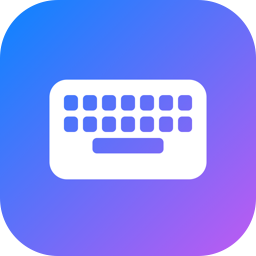
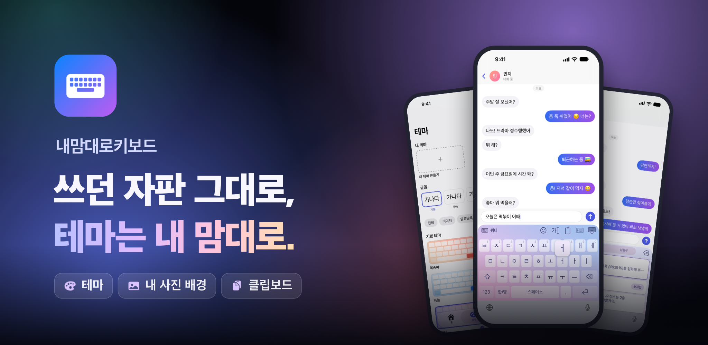

# 내맘대로키보드

**쓰던 자판 그대로, 테마는 내 맘대로**

입력한 내용은 기기 밖으로 나가지 않는 iPhone·iPad 키보드

천지인부터 쿼티까지 7가지 한국어 자판, 17개 언어, 62가지 테마. 
손에 익은 자판 그대로 치면서 키보드를 내 취향대로 꾸며 보세요.

  

## 치는 것부터 꾸미는 것까지

손에 익은 자판은 그대로 두고, 보이는 것과 치는 맛은 내 취향대로 바꿀 수 있게 만들었어요. 모든 기능은 무료예요.

| | 기능 | 이런 걸 할 수 있어요 |
|:-:|---|---|
| ⌨️ | **쓰던 자판 그대로** | 쿼티·천지인·단모음·나랏글·스카이 등 7가지 한국어 자판을 손에 익은 그대로 써요. 숫자 줄, 한 손 모드, 키 높이·간격, 가로 화면 자판까지 내 손에 맞게 바꿔요. |
| 🌐 | **17개 언어·번역** | 키보드 하나에서 언어 키 하나로 17개 언어를 오가요. 일본어 가나·로마자 변환, 중국어 병음·주음, 베트남어 Telex·VNI까지 나라마다 쓰던 방식 그대로예요. iOS 26 이상에서는 친 글을 기기 안에서 번역해 바로 넣어요. |
| 🎨 | **62가지 테마** | 그라데이션 21가지를 포함한 62가지 테마예요. 알록달록한 키, 그림 같은 하늘, 마블과 골드, 리퀴드 글래스까지 누르면 바로 바뀌고, 프리미엄 테마는 광고 한 번만 보면 계속 쓸 수 있어요. |
| 🖌️ | **테마 직접 만들기** | 색 두세 개와 방향만 고르면 나만의 그라데이션이 완성돼요. 내 사진 배경, 키 색·모양, 16가지 키 글꼴까지 직접 고르고, 만들면서 아래 키보드로 바로 쳐 봐요. |
| 📋 | **클립보드** | 복사한 내용을 모아 두고 한 번에 붙여넣어요. 인증번호는 숫자만 쏙 넣고, 길게 누르면 전체를 보거나 고쳐서 붙여넣어요. 카드번호·주민등록번호·비밀번호는 저장하지 않아요. |
| 💬 | **상용구 단축어** | '@주소'처럼 정해 두고 스페이스만 누르면 펼쳐져요. iOS 텍스트 대치도 그대로 돼요. |
| 😀 | **이모지 검색** | '축하'처럼 낱말만 쳐도 바로 찾아요. 이모티콘·특수문자도 한곳에 모았어요. |
| 🖐️ | **커서·편집** | 스페이스를 길게 누르면 키보드가 터치패드로 바뀌어 커서를 옮기고, 편집 패널에서는 복사·잘라내기·붙여넣기까지 해요. 지우기 키를 끌면 단어 단위로 지우고, 반대로 끌면 방금 지운 내용을 되살려요. |
| 👆 | **밀어서·끌어서 입력** | 쿼티 자판에서 글자 키를 위로 밀면 숫자·기호, 아래로 밀면 대문자·쌍자음이 들어가요. 한국어·영어 쿼티는 키를 누른 채 끌어서 단어를 칠 수도 있어요. 둘 다 설정에서 켜면 돼요. |
| 🔊 | **키 소리·눌림 효과** | 타자기·기계식·버블 등 9가지 키 소리와 하트·반짝·물결 같은 눌림 효과, 진동 세기까지 골라요. 소리는 무음 모드와 벨소리 음량을 따라요. |
| ⚙️ | **빠른 설정·iCloud 동기화** | 키보드 안 ⚙︎에서 언어·자판·테마·진동·소리를 바로 바꿔요. iCloud 동기화를 켜 두면 설정·테마·상용구와 고정한 클립보드 항목을 같은 Apple 계정의 기기와 맞춰요. |

## 이럴 때 써 보세요

**메시지를 주고받을 때**
- 스페이스를 길게 눌러 커서를 옮기고, 지우기 키를 끌어 단어째 지워요.
- '축하'처럼 낱말만 쳐서 이모지를 찾아 넣어요.

**인증번호나 주소를 넣을 때**
- 인증 문자를 복사해 두면 클립보드에서 숫자만 쏙 넣어요.
- '@주소'처럼 정해 둔 단축어를 치고 스페이스만 누르면 주소가 펼쳐져요.

**외국어로 쓸 때**
- 언어 키 하나로 17개 언어를 오가며, 그 나라에서 쓰던 자판 그대로 쳐요.
- iOS 26 이상에서는 툴바의 文A로 친 글을 번역해 입력창에 바로 넣어요.

**키보드가 지루해졌다면**
- 62가지 테마에서 고르거나, 색 두세 개와 방향만 골라 나만의 그라데이션을 만들어요.
- 내 사진을 배경으로 깔고, 키 글꼴과 키 소리·눌림 효과까지 바꿔 봐요.

## 입력은 기기 안에서만

키보드는 내가 쓰는 모든 글을 봐요. 그래서 아무것도 남기지 않고, 아무 데도 보내지 않게 만들었어요.

- **키보드는 인터넷을 쓰지 않아요** — 키보드 확장에는 네트워크 기능이 없어요. 입력한 글자는 어디에도 보내지 않아요.
- **광고는 앱 화면에만** — 키보드에는 광고가 없어요. 입력한 내용은 광고에 쓰이지 않아요.
- **기록은 이 기기에만** — 설정·테마·클립보드 기록은 기기에만 저장되고, 앱을 지우면 함께 지워져요. iCloud 동기화를 켜면 설정·테마·상용구·고정한 항목은 내 iCloud에도 저장돼요.
- **민감한 건 남기지 않아요** — 카드번호·주민등록번호·비밀번호로 보이는 내용은 클립보드 기록에 저장하지 않아요.

'전체 접근'을 켤 때 iOS가 보여 주는 경고는 모든 서드파티 키보드에 똑같이 나오는 문구예요. 전체 접근은 진동·클립보드·앱과 설정 맞추기에만 쓰고, 무언가를 보내는 데 쓰지 않아요.

## 다운로드

무료로 이용할 수 있어요. iOS 16.0 이상의 iPhone과 iPad에서 쓸 수 있어요.

- **iOS** — [App Store에서 받기](https://apps.apple.com/kr/app/id6818359175)

받은 뒤 **설정 › 일반 › 키보드 › 키보드 › 새로운 키보드 추가**에서 내맘대로키보드를 고르면 바로 쓸 수 있어요. '전체 접근 허용'은 선택이에요. 켜면 키 진동, 복사한 내용 저장, 앱과 설정 동기화를 쓸 수 있고, 켜지 않아도 모든 자판으로 입력할 수 있어요.

## 소식·문의

- 홈페이지 — [mywaykeyboard.kakaosoft.co.kr](https://mywaykeyboard.kakaosoft.co.kr)
- 문의 — [admin@kakaosoft.co.kr](mailto:admin@kakaosoft.co.kr)
- 버그 제보·기능 제안 — [Issues](https://github.com/ParkMyungJae/mywaykeyboard/issues)에 남겨 주세요. 하나하나 읽고 있어요.

[개인정보처리방침](https://mywaykeyboard.kakaosoft.co.kr/privacy/)

---

이 저장소는 내맘대로키보드 앱을 소개하는 공간이에요.

© 2026 내맘대로키보드. All rights reserved.

